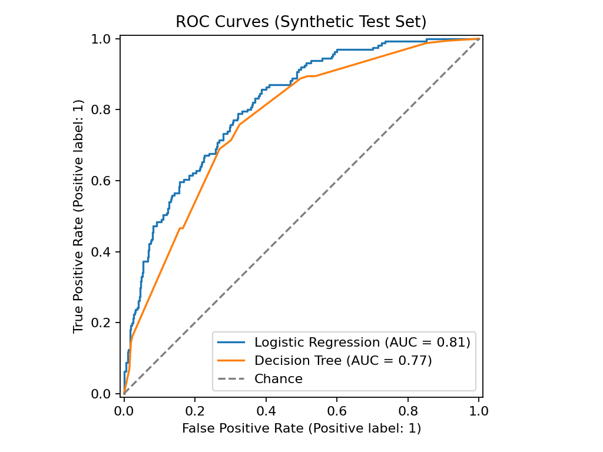

# Credit Risk Analytics: SQL Server + Python + Machine Learning

A small end-to-end credit-risk workflow on synthetic borrower data: SQL Server portfolio analysis, exploratory analysis in Python, and two baseline classifiers (Logistic Regression and a Decision Tree) compared with ROC-AUC, precision, recall and F1.

> **Data notice:** this repository uses entirely synthetic data. `default_flag` comes from a simulated risk process, not from real borrowers or observed loan outcomes. The metrics demonstrate the workflow only and do not show real-world lending performance.

## Project goals
- Load a borrower dataset into Microsoft SQL Server and summarise portfolio composition and default rates with SQL.
- Explore risk-related variables in Python (pandas, matplotlib).
- Train Logistic Regression and a Decision Tree, with the train/test split done before any scaling.
- Evaluate beyond accuracy, and read the tree to see which features drive its splits.

## Repository structure
```text
credit-risk-analytics/
├── data/
│   ├── raw/borrowers.csv              # 2,500 synthetic borrowers
│   └── DATA_DICTIONARY.md             # column definitions
├── notebooks/credit_risk_analysis.ipynb
├── sql/
│   ├── 01_create_database_and_table.sql
│   ├── 02_import_csv_instructions.sql
│   └── 03_portfolio_analysis.sql
├── src/analyze_credit_risk.py         # same analysis as the notebook, as a script
├── reports/
│   ├── figures/                       # charts written by the script
│   └── model_metrics.json
├── requirements.txt
├── LICENSE
└── README.md
```

## Quick start

### 1. Python environment
Python 3.10+ is recommended (developed and tested on 3.12).

```bash
python -m venv .venv
# Windows:
.venv\Scripts\activate
# macOS/Linux:
source .venv/bin/activate
pip install -r requirements.txt
```

### 2. Run the analysis script
From the project root:

```bash
python src/analyze_credit_risk.py
```

It prints the metrics, and regenerates the figures in `reports/figures/` and `reports/model_metrics.json`.

### 3. Run the notebook
Open `notebooks/credit_risk_analysis.ipynb` in Jupyter and run the cells top to bottom. It reads `data/raw/borrowers.csv`. The saved notebook already contains its outputs and charts.

### 4. SQL Server / SSMS
1. Run `sql/01_create_database_and_table.sql` (note: it drops and recreates `dbo.Borrowers`).
2. Load the CSV into `dbo.Borrowers` using the wizard or `BULK INSERT` (see `sql/02_import_csv_instructions.sql`). The row count should be 2,500.
3. Run `sql/03_portfolio_analysis.sql`.

## Methods
- **Checks:** shape, missing values, duplicate IDs, summary statistics.
- **EDA:** default-label counts, credit score and debt-to-income by default label.
- **Features:** `borrower_id` and the target are dropped; `home_ownership` and `loan_purpose` are one-hot encoded.
- **Split:** stratified 75/25 train/test split (`random_state=42`).
- **Logistic Regression:** numeric features standardised, with the scaler fit on the training set only; `class_weight="balanced"`.
- **Decision Tree:** no scaling needed; `max_depth` chosen by 5-fold cross-validation on the training set (the test set is not used for tuning); `min_samples_leaf=20`, `class_weight="balanced"`.
- **Evaluation:** accuracy, precision, recall, F1, ROC-AUC, confusion matrix, and a classification report, all at the default 0.5 threshold.

## Results (synthetic test set, 625 borrowers)

| Model | Accuracy | Precision | Recall | F1 | ROC-AUC |
|---|---|---|---|---|---|
| Logistic Regression | 0.712 | 0.464 | 0.770 | 0.579 | 0.813 |
| Decision Tree (max_depth=4) | 0.696 | 0.447 | 0.758 | 0.562 | 0.768 |

Both models use `class_weight="balanced"`, which raises recall at the cost of precision: many non-defaulters get flagged. The tree's splits are dominated by `credit_score`, then `debt_to_income_ratio` and `annual_income` (see `reports/figures/decision_tree.png` and `feature_importance.png`). Because the labels were generated from a designed formula, this mostly shows the models recovering that formula.



## Limitations and next steps
- Synthetic data only, with no external validation. The script that generated the CSV is not included.
- `debt_to_income_ratio` is a simulated feature and is not derived from `existing_debt` and `annual_income` (see the data dictionary).
- One train/test split; the metrics on 625 test rows carry noticeable sampling noise.
- No calibration, fairness, stability or economic-cost analysis, and the decision threshold is fixed at 0.5.
- Not a lending decision tool. Real use would need validated real-world data, governance, explainability, monitoring and compliance review.

## License
MIT. See `LICENSE`.
